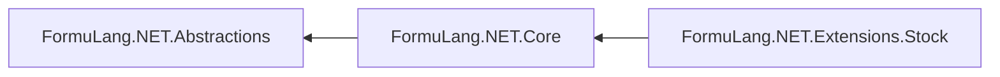

<div align="center">

<picture>
  <source media="(prefers-color-scheme: dark)" srcset="./raw/images/icons/logotype-dark.svg" />
  <source media="(prefers-color-scheme: light)" srcset="./raw/images/icons/logotype-light.svg" />
  
</picture>

**FormuLang.NET** is a multi-platform, modular C# library implementing the [**FormuLang**](https://github.com/Adisoreq/FormuLang) standard.


[](#project-status)

[**Documentation**](docs/README.md) · [**Getting started**](docs/getting-started.md) · [**Conformance**](docs/conformance.md) · [**Changelog**](CHANGELOG.md)

</div>


## Overview

[FormuLang](https://github.com/Adisoreq/FormuLang) is a formula-based scripting language standard: a host application embeds an interpreter and lets its users write text formulas such as

```php
$principal := 1000
$rate := 0.05
$principal * (1 + $rate) ^ 10
```

**FormuLang.NET** is the reference implementation of that standard for .NET. It turns a formula into a single result value by running the execution pipeline defined by the standard:

**validation** → **clean-up** → **tokenization** → **parsing** → **evaluation** → **finalization**

Each stage is defined by an interface in `FormuLang.NET.Abstractions` and implemented in `FormuLang.NET.Core`, so a host application can replace any single stage with its own implementation.

> [!NOTE]
> The standard and this library are developed in parallel. The library currently targets **Core `core-0.3`** and **Stock `stock-0.1`** (in progress). See [Conformance](docs/conformance.md) for what is implemented and what is not yet.


## Library modules

Module list:

| Module | Description | Status |
| :----- | :---------- | :----- |
| [**FormuLang.NET.Abstractions**](src/FormuLang.NET.Abstractions) | Interfaces and enumerations shared by every module: primitives (`IValue`, `IType`, `IContainer`, `IFunction`), pipeline stages (`IValidator`, `ICleaner`, `ITokenizer`, `IParser`, `IEvaluator`), structures (`IEnvironment`, `IContext`, `IStandard`). No dependencies. | In progress |
| [**FormuLang.NET.Core**](src/FormuLang.NET.Core) | Implementation of the **Core** standard: the execution pipeline, primitives, errors, operators, built-in functions and procedures. | In progress |
| [**FormuLang.NET.Extensions.Stock**](src/FormuLang.NET.Extensions.Stock) | Implementation of the **Stock** extension standard: the `Stock.Candle` type, the Stock, Indicator, Pattern and Strategy contexts, the indicator registry, `CANDLE` and `INDICATOR`. | In progress |

Dependency tree:



More: [Architecture](docs/architecture.md).


## Quick example

```csharp
using FormuLang.NET.Core.Processing;
using FormuLang.NET.Core.Structures;
using Environment = FormuLang.NET.Core.Structures.Environment;

var environment = Environment.Create();       // Core standard: functions, constants, variables
var context = Context.Create(environment);    // basic Core context, chosen by the host application

ExecutionResult result = Executor.Create().Execute("""
    $principal := 1000
    $rate := 0.05
    ROUND($principal * (1 + $rate) ^ 10, 2)
    """, context);

Console.WriteLine(result.Successful ? result.Value : result.Error);   // 1628.89
```

The host application chooses the context a formula runs in: the basic Core context, a persistent one, or a context type that provides its own data (e.g. the candles of a stock indicator). Errors are values: a formula that fails returns an **Error** such as `[OPERATION_ERROR (3)] Division by zero.` instead of throwing. See [Getting started](docs/getting-started.md) and the [CalculatorCLI sample](samples/CalculatorCLI).


## Building

Requirements: [.NET SDK 8.0](https://dotnet.microsoft.com/download) or newer.

```bash
dotnet build FormuLang.NET.sln
```

```bash
dotnet run --project samples/CalculatorCLI -- "2 + 2 * 2"
```

```bash
dotnet test FormuLang.NET.sln
```


## Project status

Current stage: **Prototyping**

Every stage of the execution pipeline and every function and procedure of the Core standard (`core-0.3`) and of the Stock standard (`stock-0.1`) is implemented and covered by conformance tests built from the examples of the standard. The remaining differences are listed in [Conformance](docs/conformance.md).

| Pipeline stage | Status |
| :------------- | :----- |
| Validation | Implemented |
| Clean-up | Implemented |
| Tokenization | Implemented |
| Parsing | Implemented |
| Evaluation | Implemented |
| Finalization | Implemented |
| Core functions and procedures | Implemented |

The public API is not stable: breaking changes can happen in any `0.x` version.


## Related projects

- [**FormuLang**](https://github.com/Adisoreq/FormuLang) - the language standard (syntax, semantics, Core standard).


## Authors

Adrian Piznal


## License

The library is licensed under the [MIT License](LICENSE).
The FormuLang standard documentation is licensed separately, under [CC BY 4.0](https://github.com/Adisoreq/FormuLang/blob/main/LICENSE.txt).

<div align="center">

</div>